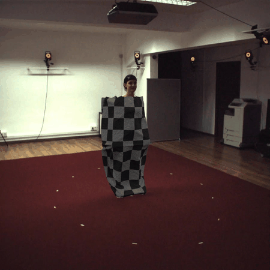
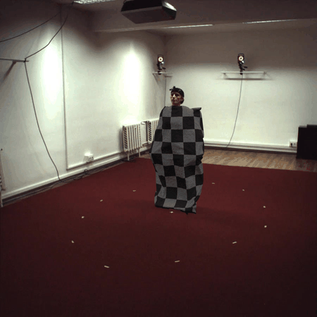
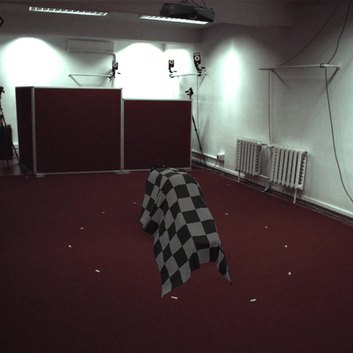

# BlanketGen2
This repositiory is the implementation of the pipeline introduced in [BlanketGen2-Fit3D: Synthetic Blanket Augmentation Towards Improving Real-World In-Bed Blanket Occluded Human Pose Estimation](https://doi.org/10.1016/j.cviu.2026.104975), (available also on [arxiv](https://arxiv.org/pdf/2501.12318)), which we used to generate [BlanketGen2-Fit3D dataset](https://doi.org/10.25747/44JY-3V61). The generated .blend files of the physically simulated blankets and the photo-realistic renders of them of BlanketGen2-Fit3D dataset is shared [here](https://doi.org/10.25747/44JY-3V61) .





## Description
The BlanketGen2 is a pipeline to augment HPE datasets with blanket occlusions to improve their performance on patients lying down in beds.

<!-- The old pipeline is avaialble at https://gitlab.inesctec.pt/brain-lab/brain-lab-public/blanket-gen-releases -->

<!-- This repository contains an improved implementation of the pipeline changed to augment Fit3D instead of 3DPW. -->

## Setting up the environment to use Blender Python to augment Fit3D
1- Install Blender (3.4 works, other versions may work too) [here](https://www.blender.org/download/)   
2- Clone this git     
3- Import the blenderenv.yml environment with conda   
4- With the conda environment activated, follow the instructions to setup SMPLX (including setting up the SMPL model) [here](https://github.com/vchoutas/smplx#downloading-the-model)   
5- Copy everything in "conda_location/envs/blenderBlanketGen/Lib/site-packages" to "blender_location\Blender 3.4\3.1\python\lib\site-packages" (skip repeated files)   
6- Download Fit3D [here](https://fit3d.imar.ro/fit3d)   
7- Update the paths in the config files          
8- Add the blender installation location to the PATH environment variable (not really necessary just makes the commands to run the code simpler)      

## Running the cloth simulation script
You can run the simulations script with the command:
```   
blender --background --python ./BlanketGen2_Cloth_Sim.py
```
It's recommended to redirect the output into a log with > clothlog.txt

## Running the render script
You can run the rendering script with the command:
```   
blender --background --python ./BlanketGen2_Render.py
```
It's recommended to redirect the output into a log with > renderlog.txt

You can start running this shortly after the simulations scripts but if it runs faster than that script it will stop prematurely (when it catches up).

## Running compositing script
You can run the compositing script with the command:
```   
blender --background --python ./BlanketGen2_Composite.py
```
It's recommended to redirect the output into a log with > compositelog.txt

## License
The code in this repository is available under a GPLv3 license.

It does, however, depend on code from third parties such as the [SMPL-X](https://smpl-x.is.tue.mpg.de/) package and the [Blender Python](https://docs.blender.org/api/current/info_overview.html) modules, so if you do use it make sure to comply with the licenses of the dependencies.

##  BlanketGen2-Fit3D - The generated dataset
[BlanketGen2-Fit3D](https://doi.org/10.25747/44JY-3V61) is an augmented version of Fit3D that was generated with the BlanketGen2 pipeline.
     
The BlanketGen2-Fit3D dataset generated with this code is available at [Zenodo](https://doi.org/10.25747/44JY-3V61), 
More information on it as well as on how to download it can be found there.

## Citations
If you use BlanketGen2 or BlanketGen please cite the following papers in which it was introduced:
```
@article{KARACSONY2026104975,
  title = {BlanketGen2-Fit3D: Synthetic blanket augmentation towards improving real-world in-bed blanket occluded human pose estimation},
  journal = {Computer Vision and Image Understanding},
  pages = {104975},
  year = {2026},
  issn = {1077-3142},
  doi = {https://doi.org/10.1016/j.cviu.2026.104975},
  url = {https://www.sciencedirect.com/science/article/pii/S1077314226003425},
  author = {Tamás Karácsony and João Carmona and João Paulo Silva Cunha},
  keywords = {Human pose estimation, Synthetic data augmentation, Occlusion handling, Healthcare monitoring}
}

@article{karacsony2025blanketgen2,
  title={BlanketGen2-Fit3D: Synthetic Blanket Augmentation Towards Improving Real-World In-Bed Blanket Occluded Human Pose Estimation}, 
  author={Tamás Karácsony and João Carmona and João Paulo Silva Cunha},
  year={2025},
  eprint={2501.12318},
  archivePrefix={arXiv},
  primaryClass={cs.CV},
  url={https://arxiv.org/abs/2501.12318}, 
}

@inproceedings{carmona2023blanketgen,
  title={BlanketGen-A Synthetic Blanket Occlusion Augmentation Pipeline for Motion Capture Datasets},
  author={Carmona, Jo{\~a}o and Kar{\'a}csony, Tam{\'a}s and Cunha, Jo{\~a}o Paulo Silva},
  booktitle={2023 IEEE 7th Portuguese Meeting on Bioengineering (ENBENG)},
  pages={112--115},
  year={2023},
  organization={IEEE}
}
```

## Support
For more information contact Tamás Karacsony at tamas.karacsony@inesctec.pt


## Authors and acknowledgment
The code was authored by João Carmona under the guidance and supervision of Tamás Karacsony and João Paulo Cunha, all 3 of whom are affiliated with INESC TEC.


